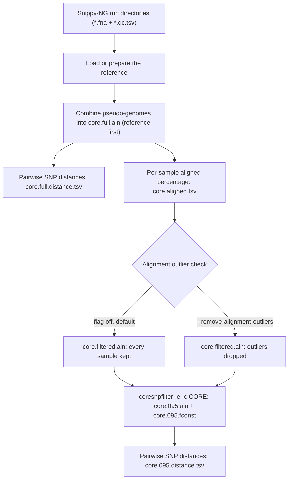
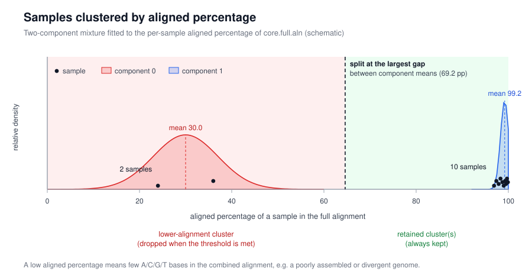
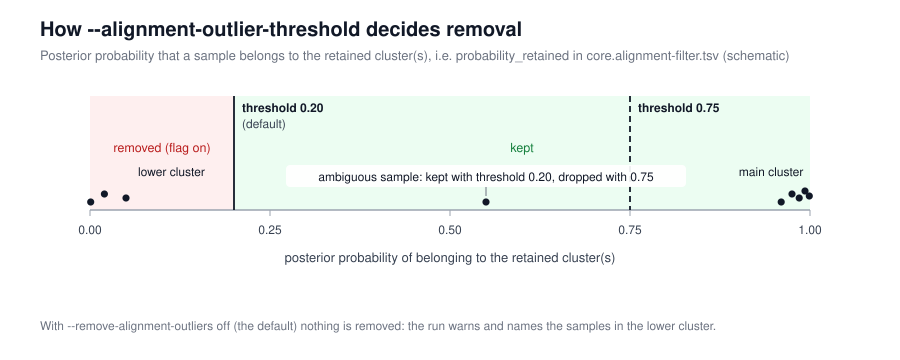

# `snippy-ng core`

Turn finished Snippy-NG runs into a core alignment: one concatenated alignment of
every sample against a shared reference, filtered down to the sites that are
present in enough samples to be worth analysing, plus pairwise SNP distances.

Use it when the per-sample work is already done — for example on the `samples/`
directory of a [`snippy-ng multi`](multi.md) run — and you want to choose the
core threshold yourself, or re-run the alignment with different settings.

## Quick start

```console
snippy-ng core multi-phix/samples/* --ref multi-phix/reference/GCF_000819615.1.fa -o core-phix
```

Each `SNIPPY_DIRS` argument is a Snippy-NG run directory containing the sample's
pseudo-genome (`*.fna`) and its QC table (`*.qc.tsv`). `--ref` is the reference
FASTA — or a prepared reference directory, as produced by `snippy-ng utils ref`
or by a previous run — used to define contig order. Unlike `multi`, `core` takes
a local reference path, not an accession.

## Worked example

Reusing the phiX174 run from [Multi-sample analysis](multi.md#worked-example-phix174):

```console
snippy-ng core multi-phix/samples/* --ref multi-phix/reference/GCF_000819615.1.fa -o core-phix
```

That finishes in a few seconds and produces an 8-sequence alignment (reference +
7 samples) of 43088 sites, which the soft-core filter reduces to 576 sites:

| Output | Result for this example |
| --- | --- |
| `core.full.aln` | 8 sequences, 43088 sites (every position in the reference) |
| `core.095.aln` | 8 sequences, 576 variable sites present in ≥95% of samples |
| `core.095.fconst` | `1273,1139,1233,1662` constant sites, for IQ-TREE `-fconst` |
| `core.095.distance.tsv` | pairwise SNP distances, e.g. `phiX174-SCSC2` vs `reference` = 25 |

Continue straight to a tree:

```console
snippy-ng tree --fast core-phix/core.095.aln -o core-phix/tree
```

## How it works



The reference is written as the first sequence of the alignment, each sample
contributes one concatenated supercontig per reference contig, and `--mask` (a
BED file in reference coordinates) turns the masked regions into `N` in every
sequence, including the reference.

## Strict core vs soft core

A site is *core* if an unambiguous base (`A`, `C`, `G` or `T`) is present there
in at least the fraction of sequences given by `--core`. Gaps, `N` and any other
character are treated the same way: as missing data. The comparison is `≥`, so
with `--core 0.8` a site with 4 of 5 unambiguous bases still counts as core.
Invariant sites are always removed, so the core alignment contains only variable
sites.

`--core 1.0` gives a **strict core**: only sites with data in *every* sample.
The default `--core 0.95` gives a **soft core**, which tolerates a little missing
data at each site and therefore keeps many more sites as datasets grow. The
trade-off is documented in Taouk et al., *Exploring SNP filtering strategies: the
influence of strict vs soft core* (Microbial Genomics 2025;11(1):001346,
[doi:10.1099/mgen.0.001346](https://www.microbiologyresearch.org/content/journal/mgen/10.1099/mgen.0.001346)):

- A strict core shrinks markedly as sample size and genome diversity increase,
  discarding potentially informative data; in a 10 000-genome *Salmonella
  enterica* serovar Typhi alignment a 95% soft core yielded **ten times more
  informative sites** than a 100% strict core, with similar patterns in
  *Neisseria gonorrhoeae*.
- Trees built from soft-core alignments generally showed better clock-like
  behaviour: the *N. gonorrhoeae* 95% soft-core phylogeny had a root-to-tip
  regression *R*² of 0.50 versus 0.21 for the strict-core phylogeny.
- The paper's conclusion is that soft-core strategies are preferable for large,
  diverse datasets — which is why `--core 0.95` is the default here.

The filtering is done by [Core-SNP-filter](https://github.com/rrwick/Core-SNP-filter)
(`coresnpfilter --core CORE --exclude_invariant`), the tool released with that
paper. Its README has an
[illustrated example](https://github.com/rrwick/Core-SNP-filter#illustrated-example)
that colours the sites removed at different thresholds; the key points are that
non-`A`/`C`/`G`/`T` characters are all treated as missing, that the core fraction
test is inclusive, and that a site can be both invariant and non-core — invariant
sites are filtered first.

The counts in `core.095.fconst` (invariant A,C,G,T counts) exist so that a tree
built from a variable-sites-only alignment can correct for the sites that were
removed, for example `iqtree -fconst 1273,1139,1233,1662`.

## Alignment outliers

The core alignment is only meaningful if the samples in it are comparable, so
before filtering, `core` looks at the **aligned percentage** of each sample in
`core.full.aln`: the fraction of its sites that are `A`/`C`/`G`/`T` rather than
gaps or ambiguity codes. A sample with a low value (a poorly assembled genome, a
contaminant, or a very divergent genome) adds gaps to every site it touches and
can pull the whole alignment down.



Samples are grouped by fitting a one- to three-component Gaussian mixture to
those percentages. Components are ordered by their means, the largest gap
between adjacent means is the split, and everything above the split is
"retained". The lower-alignment component(s) are the candidates for removal.



Each sample's `probability_retained` — its posterior probability of belonging to
the retained component(s) — is compared with `--alignment-outlier-threshold`
(default `0.20`). Samples below the threshold are dropped. Because clusters are
usually well separated, posteriors are near `0.0` or `1.0` and the exact
threshold rarely changes the outcome; it matters for samples that fall between
clusters.

Removal is **off by default**. With the flag off, nothing is removed and the run
warns instead, naming the samples in the lower cluster:

```text
Alignment core.full.aln splits into 2 clusters (largest gap 80.0 percentage points);
kept the lower-alignment cluster(s): s11, s12. Rerun with --remove-alignment-outliers
(threshold 0.20) to drop them, or inspect core.alignment-filter.tsv
```

To drop them:

```console
snippy-ng core multi-phix/samples/* --ref reference.fa --remove-alignment-outliers -o core-phix
```

Small cohorts (fewer than 10 samples) are too small to fit a mixture model, so a
robust one-sided MAD rule is used instead: samples far below the median aligned
percentage are outliers, and `--alignment-outlier-threshold` is not used. The
same warning/flag behaviour applies.

Every per-sample decision is recorded in `core.alignment-filter.tsv`
(`aligned`, `assigned_component`, `probability_retained`, `removed`,
`filter_reason`), and the run also checks whether the mixture components simply
track the input type (`pipeline_type` from each sample's `*.qc.tsv`) in
`core.alignment-cluster-technical-check.tsv` — a strong association means the
clusters are technical, not biological.

## Options

| Option | Default | Purpose |
| --- | --- | --- |
| `SNIPPY_DIRS...` | – | One or more Snippy-NG run directories (`*.fna` plus `*.qc.tsv`) |
| `--reference`, `--ref` | required | Reference FASTA or prepared reference directory, used for contig order |
| `--core` | `0.95` | Fraction of samples that must have an unambiguous base at a site for it to stay in the core alignment |
| `--remove-alignment-outliers` | disabled | Drop detected low-alignment outlier samples before core filtering |
| `--alignment-outlier-threshold` | `0.20` | Posterior probability of belonging to the retained clusters; only used with `--remove-alignment-outliers` and cohorts large enough for mixture modelling |
| `--snp-distance-format` | `tabular` | Format of the pairwise SNP distance matrix: `tabular` or `phylip` |
| `--mask` | none | BED file (reference coordinates) of regions to mask with `N` in every sequence |

Global options (`-o/--outdir`, `-p/--prefix`, `-c/--cpus`, `-r/--ram`, `--force`,
`--skip-check`, `--create-missing`, `--no-cleanup`, `--quiet`, `--debug`, ...)
are shared with the other commands. Run `snippy-ng core -h` for the full list.

## Outputs

With `-o core-phix` and the default `-p core`:

```
core-phix/
├── core.full.aln                          all samples, every reference position
├── core.full.distance.tsv                 pairwise SNP distances (full alignment)
├── core.aligned.tsv                       per-sample aligned percentage
├── core.filtered.aln                      alignment after the outlier check
├── core.alignment-filter.tsv              per-sample outlier decisions and mixture diagnostics
├── core.alignment-cluster-technical-check.tsv  do components track pipeline_type?
├── core.095.aln                           soft core alignment (suffix follows --core)
├── core.095.fconst                        invariant site counts for IQ-TREE -fconst
└── core.095.distance.tsv                  pairwise SNP distances (core alignment)
```

`--core 1.0` writes `core.100.aln`; the same rule applies to the `.fconst` and
`.distance.tsv` files. Every pipeline directory also gets `LOG.txt`,
`FILES.tsv`, `CITATIONS.txt` and `PIPELINE.txt`.

## See also

- [Multi-sample analysis](multi.md): the `multi` command that produces the input directories
- [Tree report](utils/report/tree.md): render the tree built from the core alignment
- [Reference preparation](utils/ref.md): prepare a reference directory with `snippy-ng utils ref`
