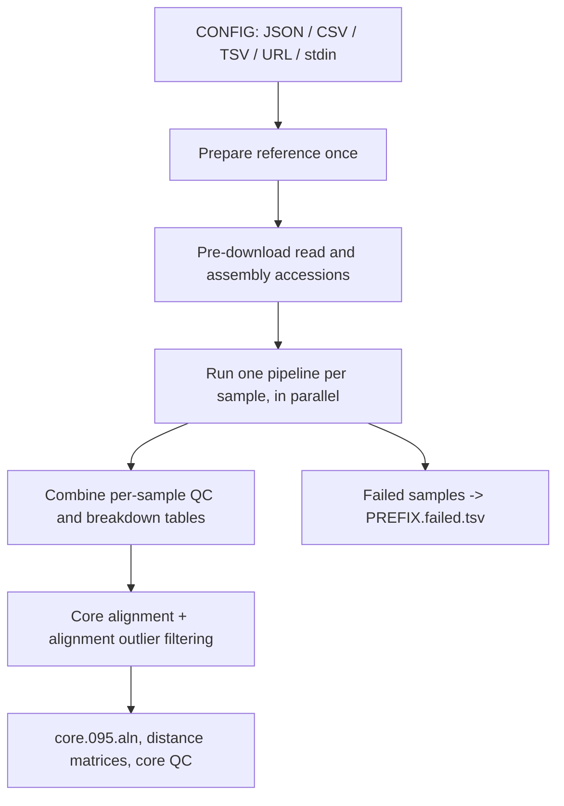

# `snippy-ng multi`

Run SNP calling for many samples against one reference and build a core
alignment from the results. Each sample can be short reads, long reads, or an
assembly, so a single run can mix input types.

## Quick start

```console
snippy-ng utils gather --json --ref reference.gbk tests/data/*.fastq.gz > samples.json
snippy-ng multi samples.json --cpus 6 -o multi
snippy-ng tree --fast multi/core/core.095.aln -o multi/tree
snippy-ng utils report tree multi/tree/tree.treefile --metadata multi/snippy.qc.tsv -o multi/report
```

`CONFIG` may be a local path, `-` for stdin, or an HTTP(S) URL:

```console
snippy-ng multi https://example.com/samples.json --ref reference.fasta
snippy-ng utils gather --ref reference.fasta --json | snippy-ng multi -
```

The reference is required, either from the config (`JSON` only) or from
`--ref`. It may be a FASTA/GenBank file, a prepared reference directory, or an
NCBI (`GCF_`/`GCA_`) or AllTheBacteria (`SAMN`/`SAMEA`) assembly accession, which
is downloaded. The reference is prepared once into `<outdir>/reference` and
reused by every sample.

## How it works



Accessions are resolved centrally into `<outdir>/downloads` before the parallel
workers start, so a repeated accession is downloaded only once.

## CONFIG

### JSON

```json
{
  "reference": "SAMN16246485",
  "samples": {
    "mutant": {
      "type": "short",
      "left": "reads/mutant_R1.fastq.gz",
      "right": "reads/mutant_R2.fastq.gz"
    },
    "wildtype": {
      "type": "asm",
      "assembly": "assemblies/wildtype.fasta"
    },
    "outbreak-1": {
      "type": "long",
      "reads_accession": "SRR1234567"
    }
  }
}
```

`reference` is optional when `--ref` is given.

### CSV / TSV

The first row is a header. `sample` and `type` are required; every other column
is a per-sample option, and empty cells are ignored. Because CSV/TSV cannot
express nested values, use `left`/`right` for short reads. The reference must be
given with `--ref`.

```csv
sample,type,left,right
mutant,short,reads/mutant_R1.fastq.gz,reads/mutant_R2.fastq.gz
wildtype,asm,assemblies/wildtype.fasta,
```

Sample names must be unique.

### Sample options

| Key | Applies to | Purpose |
| --- | --- | --- |
| `type` | all | `short`, `long`, or `asm` (required) |
| `left`, `right` | short | Read files; `left` alone means single-end |
| `reads` | short, long | Read file(s); a string or a list of paths |
| `assembly` | asm | Assembly FASTA |
| `reads_accession` | short, long | SRA accession (`SRR`/`ERR`/`DRR`) to download |
| `assembly_accession` | asm | NCBI (`GCF_`/`GCA_`) or AllTheBacteria (`SAMN`/`SAMEA`) accession |
| `bam` | short, long | Use a pre-aligned BAM/CRAM instead of aligning reads |
| `vcf` | all | Use an existing VCF instead of calling variants |

Any other option accepted by the corresponding single-sample pipeline can also
be set per sample, for example `caller`, `model`, `aligner`, `min_depth`,
`mask`, or `downsample`. Keys that the pipeline does not accept are dropped with
a debug log message. Samples are routed to the pipeline matching their `type`,
and each one is written to its own directory, so samples never overwrite each
other.

## Options

| Option | Default | Purpose |
| --- | --- | --- |
| `CONFIG` | – | CSV, TSV, or JSON config, `-` for stdin, or an HTTP(S) URL |
| `--reference`, `--ref` | from JSON config | Reference genome, prepared reference directory, or assembly accession |
| `--core` | `0.95` | Fraction of samples a site must be present in to be kept in the core alignment |
| `-i`, `--inclusion-threshold` | `0.0` | Posterior probability threshold for retaining a sample in the alignment-percentage clusters. `0` keeps every sample and only warns about detected clusters; a positive value (for example `0.20`) removes low-alignment outlier samples before the core alignment is built |
| `--cpus-per-sample` | auto | CPUs allocated to each sample pipeline |
| `--stop-on-failure` | disabled | Stop the run as soon as any sample fails, instead of continuing |

Global options (`-o/--outdir`, `-p/--prefix`, `-c/--cpus`, `-r/--ram`,
`--force`, `--skip-check`, `--create-missing`, `--no-cleanup`, `--quiet`,
`--debug`, ...) are shared with the other commands. Run `snippy-ng multi -h` for
the full list.

### Parallelism

Samples run in parallel, each in its own worker process. `--cpus` is the total
CPU budget for the run: with `--cpus-per-sample N` each worker gets `N` CPUs and
the number of workers is `--cpus / N`. Without `--cpus-per-sample`, the budget
is split so that workers divide `--cpus` evenly, preferring fewer workers that
each get a larger share (roughly one worker per four CPUs, capped at the number
of samples).

### Alignment clusters

Before the core alignment is built, the per-sample aligned percentages are
checked for low-alignment outliers. By default nothing is removed: when the
samples look like they split into clusters, or when a sample looks like a
low-alignment outlier, `snippy-ng` prints a warning naming the affected samples
and records the decision for every sample in `core/core.alignment-filter.tsv`.

Re-run with a positive `--inclusion-threshold` to remove those samples:

```console
snippy-ng multi samples.json -i 0.20
```

For cohorts of ten or more samples the threshold is applied to the posterior
probability of belonging to the retained clusters. Smaller cohorts use a robust
one-sided MAD rule instead, where any positive threshold enables removal.

## Outputs

With `-o multi` and the default `-p snippy`:

```
multi/
├── reference/                     prepared reference (FASTA, .fai, .dict, .gff, metadata.json)
├── samples/<sample>/              one Snippy-NG run directory per successful sample
│   ├── snippy.all.vcf.gz
│   ├── snippy.pass.vcf
│   ├── snippy.tab
│   ├── snippy.fna
│   ├── snippy.qc.tsv
│   └── snippy.report.html
├── core/
│   ├── core.full.aln              all samples, ungapped alignment
│   ├── core.full.distance.tsv     pairwise SNP distance matrix (full alignment)
│   ├── core.aligned.tsv           per-sample aligned percentage
│   ├── core.filtered.aln          alignment after outlier filtering
│   ├── core.alignment-filter.tsv  per-sample filter decision
│   ├── core.alignment-cluster-technical-check.tsv
│   ├── core.095.aln               soft core alignment (suffix follows --core)
│   ├── core.095.fconst            constant-site counts for phylogenetic correction
│   └── core.095.distance.tsv      pairwise SNP distance matrix (core alignment)
├── snippy.qc.tsv                  combined per-sample QC, plus core_aligned_percent
├── snippy.vcf.breakdown.tsv       combined per-sample variant breakdown
└── snippy.failed.tsv              samples that failed, with the error message
```

`-p/--prefix` controls the sample outputs and the combined `qc`, `vcf.breakdown`
and `failed` tables. Core alignment files always use the `core` prefix, and the
`--core` value appears in the core alignment file names (`0.95` → `core.095.aln`,
`1.0` → `core.100.aln`). Files from accessions that were downloaded are cached
under `<outdir>/downloads`.

## Failures

By default a failing sample does not stop the run: its error is recorded in
`<prefix>.failed.tsv`, the sample is dropped, and the core alignment is built
from the samples that succeeded. If every sample fails, the run stops with an
error instead of producing an empty alignment.

With `--stop-on-failure` the run stops at the first failure and reports all
samples that failed, which is useful in automated pipelines where a partial
result is worse than no result.

## See also

- [Sample discovery](utils/gather.md): build a config from a directory of files
- [Utilities](utils/index.md): reference preparation, tree and sample reports
- [GUI](gui.md): run the multi-sample pipeline from a browser
